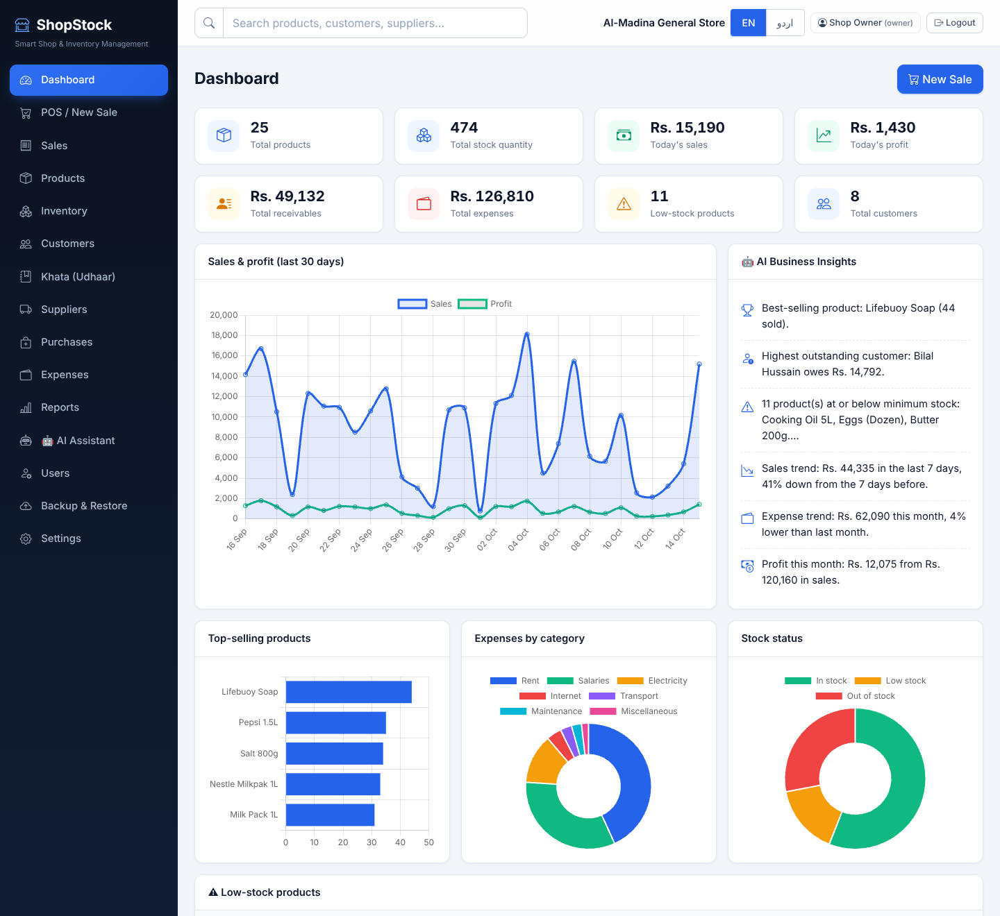
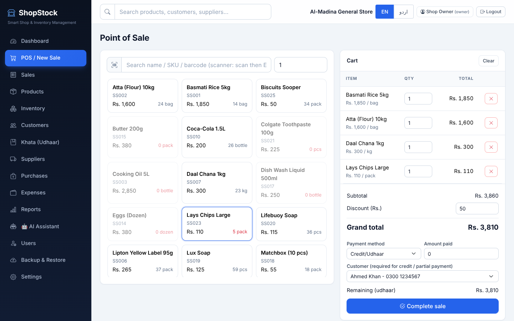
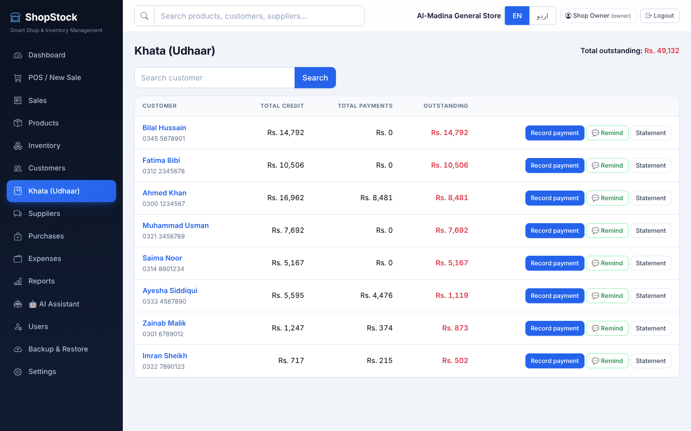
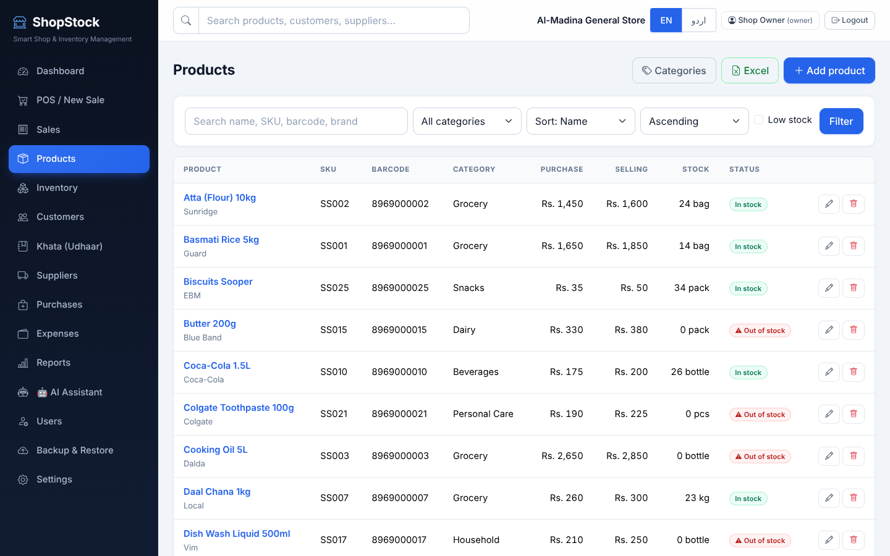
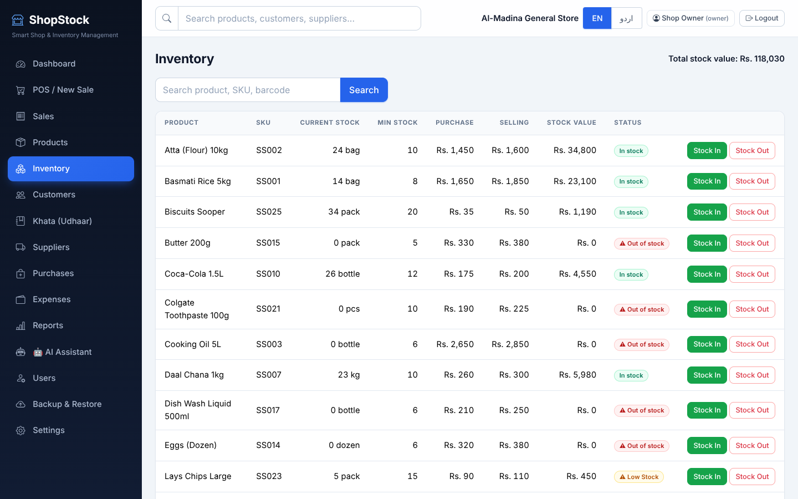
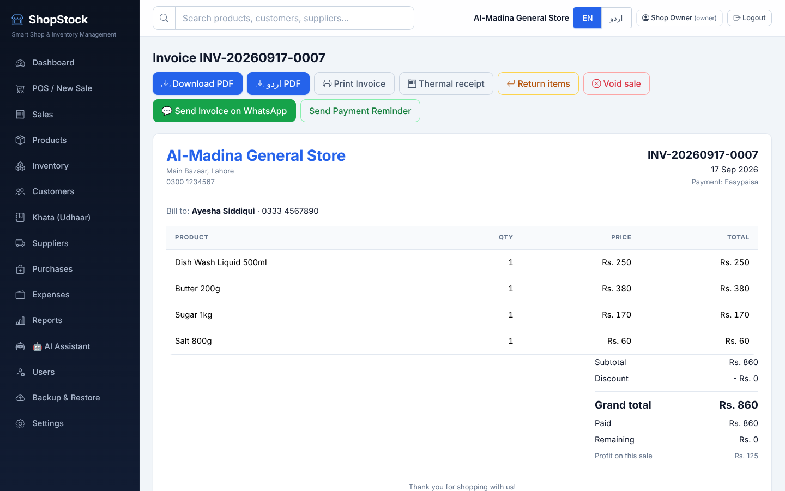
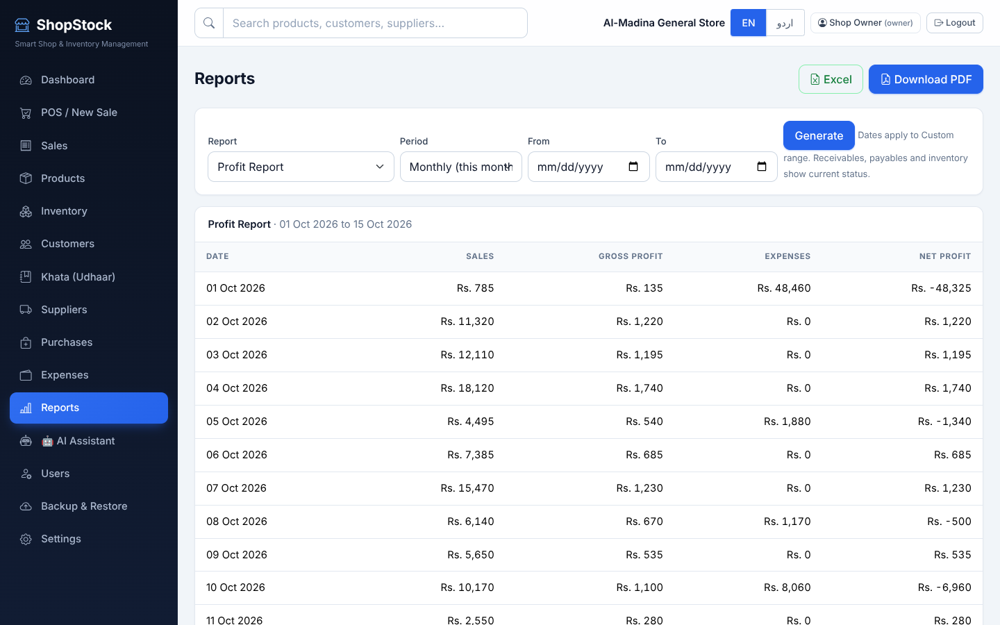
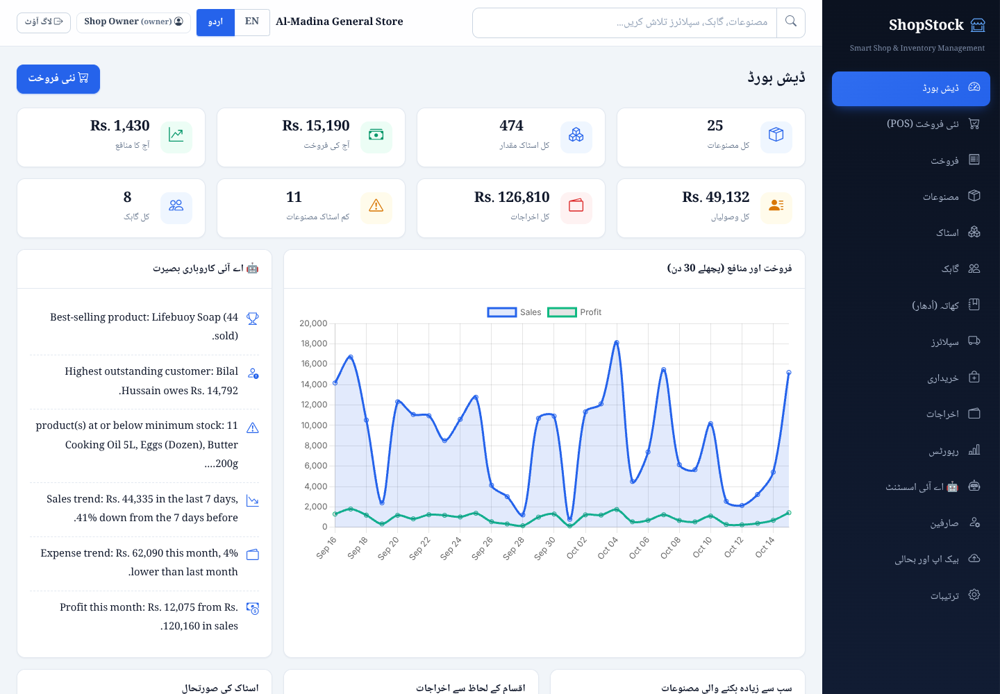
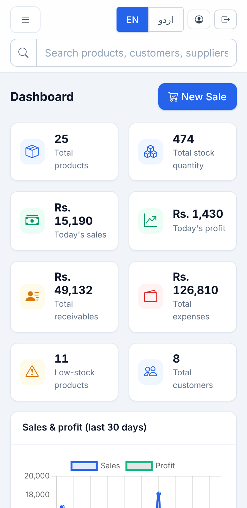

<div align="center">

# 🏪 ShopStock

### Smart Shop & Inventory Management

**A complete, offline-capable business system for small retail shops in Pakistan** — POS, inventory, khata (udhaar), suppliers, reports, PDF invoices, WhatsApp and a read-only AI assistant.

     



</div>

> Screenshots use **sample data** loaded with `tools/load_sample_data.py`. A fresh install starts empty.

## Screenshots

| Point of Sale | Khata (udhaar) |
|---|---|
|  |  |
| **Products & low-stock alerts** | **Inventory** |
|  |  |
| **Invoice (PDF / print / WhatsApp)** | **Reports (PDF & Excel)** |
|  |  |
| **Urdu (right-to-left) interface** | **Mobile** |
|  |  |

## Highlights
- **Real data only** — every number and chart comes from recorded transactions; balances can't be edited by hand
- **Pakistan-ready** — Cash, Bank, Easypaisa, JazzCash, Credit/Udhaar; Urdu UI and Urdu PDF invoices
- **Safe by design** — password hashing, CSRF protection, role-based access (Owner / Cashier), stock can never go negative
- **Business-ready** — returns & void, backups (daily + restore), Excel export, thermal receipts, Windows installer scripts
- **Tested** — 150+ automated end-to-end checks covering the whole sales, stock, khata and backup workflow

---

> 🌐 **Project website:** https://YOUR-PROJECT.vercel.app · 📘 Publishing guide: [`docs/PUBLISHING.md`](docs/PUBLISHING.md)

## What's new in v2.3 — Delete buttons everywhere
Owners can now delete **products, customers, suppliers, sales, purchases and expenses** (trash icon in each list; sales also have a Delete button on the invoice page). Every delete asks for confirmation and explains what it affects:
- **Sale** – removed from reports/khata; optionally puts the items back in stock.
- **Purchase** – removed and its stock taken back out (never below zero).
- **Product** – past sales/purchases keep the product name in their history.
- **Customer** – their sales stay in reports as walk-in sales; khata payments are erased.
- **Supplier** – also deletes its purchase records and payments; stock is unchanged.
- Cashiers cannot delete anything. Take a backup first if unsure (Backup page); older databases upgrade automatically.

## What's new in v2.2
- **Interface polish & CSS fixes** — fixed the transparent boxes/modals (a damaged bundled Bootstrap file), dashboard cards and charts (doughnut/bar charts drew wrong axes), mobile top bar and right-to-left sidebar. New design system in `static/css/style.css` (tokens, solid surfaces, consistent buttons/forms/tables/badges/modals, responsive + print rules). Checked in a real browser on desktop, mobile and Urdu (RTL).

## What's new in v2.1
- **Urdu PDF invoices and khata statements** (right-to-left, proper Urdu font bundled). Every invoice has *Download PDF* (English) and *اردو PDF* buttons; choose the default language in Settings → *Invoice language*. Urdu product/customer names typed into the system print correctly.

## What's new in v2
- **Windows program + installer** (PyInstaller + Inno Setup scripts included) and production server (Waitress)
- **Backup & Restore** page: automatic daily backup (last 14 kept), manual/download backups, restore from file, optional extra folder (USB/OneDrive)
- **Offline** — Bootstrap, icons and Chart.js are bundled in `static/vendor`
- **Returns & Void** — partial item returns (refund / udhaar adjustment, stock back, profit corrected) and voiding a mistaken sale
- **Users & roles** — Owner and Cashier; cashiers cannot see cost prices, profit, reports, expenses, suppliers, backups or settings
- **Thermal receipt** (80 mm) page, **Excel (.xlsx) export** of products, customers, suppliers, sales, expenses and every report
- **Urdu interface** (EN / اردو switch) for navigation, dashboard, POS and receipts — other screens remain English; Urdu PDF invoices/statements (v2.1)
- **Forced password change** at first login (the starting password `admin123` stops working as a long-term password)
- Older v1 databases are upgraded automatically on first start

## Features
Login • Dashboard with real charts & insights • Products (SKU, barcode, categories, low-stock ⚠) • Inventory (Stock In/Out, full movement history, never negative) • POS (Cash, Bank, Easypaisa, JazzCash, Credit/Udhaar; barcode scanner works) • Customers & Khata (statements, PDF, WhatsApp reminders) • Suppliers & Purchases (Paid/Partial/Unpaid) • Expenses • Reports (sales, profit, expenses, inventory, receivables, payables → PDF & Excel) • PDF invoices • AI Assistant (Gemini, optional)

## Run it (developer / Windows CMD)
```cmd
cd C:\Users\pc\Desktop\ShopStock
python -m venv venv
venv\Scripts\activate
pip install -r requirements.txt
python app.py
```
The browser opens **http://127.0.0.1:5000**. Or double-click `start_shopstock.bat`.

**First login:** username `admin`, password `admin123` → ShopStock immediately asks you to choose a new password.

## Build the Windows program & installer (for selling)
1. On a Windows PC with Python 3.11+: double-click **`build_windows.bat`** → creates `dist\ShopStock\ShopStock.exe`.
2. Install **Inno Setup** (free) → open `installer.iss` → *Build → Compile* → `installer_output\ShopStock-Setup.exe` (with Desktop shortcut).

The packaged app keeps data in `%LOCALAPPDATA%\ShopStock` (database, backups, `.env`), so updating or reinstalling never deletes customer data. *(Note: the packaging scripts were verified on Linux; run one test build on Windows before shipping.)*

## Using it on several PCs in one shop
Start with `SHOPSTOCK_HOST=0.0.0.0` (e.g. `set SHOPSTOCK_HOST=0.0.0.0` before running). Other PCs/phones on the same Wi-Fi open `http://<owner-PC-IP>:5000`. Give each person their own user (Users page). Only do this on a trusted shop network.

## Roles
| | Owner | Cashier |
|---|---|---|
| POS, sales list, invoices/receipts | ✔ | ✔ |
| Customers, khata payments, WhatsApp | ✔ | ✔ (no delete) |
| Products | add/edit/delete, see cost | view only, no cost price |
| Dashboard, reports, expenses, suppliers, purchases, inventory, AI | ✔ | ✘ |
| Void sale, returns, users, backup, settings, Excel export | ✔ | ✘ |

## Backup & restore
Owner → **Backup & Restore**. A backup is made automatically every day; use *Create backup* before big changes and copy backups to a USB drive (or set the *Extra backup folder*). Restoring takes a safety copy of the current data first and logs everyone out.

## How numbers work
Stock value = purchase price × qty • Sale profit = total after discount − cost of items sold • Return reduces sale total and profit; the refund first reduces the customer's udhaar, the rest is refunded in cash • Customer balance = unpaid sale amounts − khata payments (cannot be edited by hand) • Supplier payable = purchases − payments • Low stock = stock ≤ minimum.

## AI Assistant (optional)
Copy `.env.example` to `.env` (in the project folder, or `%LOCALAPPDATA%\ShopStock` for the packaged app) and set `GEMINI_API_KEY=...`, then restart. Without a key the page says "AI Assistant is not configured." The AI only receives small, relevant summaries (never passwords, hashes, keys or sessions) and cannot change anything.

## Optional sample data (testing only)
`python tools\load_sample_data.py` fills an **empty** shop with example products/sales. Never use on a customer's real shop. Delete `instance\shopstock.db` to remove it.

## Tests
`python tests\test_workflow.py` — 140+ end-to-end checks on a temporary database (does not touch your data).

## Folder structure
```
ShopStock/
├── app.py  run_shopstock.py  config.py  utils.py  requirements.txt  .env.example
├── models/  routes/  services/  templates/  static/ (css, js, vendor)  tests/  tools/  docs/
├── build_windows.bat  shopstock.spec  installer.iss  start_shopstock.bat
├── LICENSE-TEMPLATE.txt  README.md
└── instance/ backups/   (created automatically: database, secret key, backups)
```

## Troubleshooting
- `python` not found → reinstall Python with "Add to PATH" or use `py`.
- Port 5000 busy → `set SHOPSTOCK_PORT=5001`.
- "Your session expired" → refresh the page and retry.
- Forgot owner password → another owner can reset it on the Users page. If none: stop the app, restore a backup or delete `instance\shopstock.db` (erases data).
- Urdu on screen looks odd → use Chrome/Edge; Urdu in PDFs uses the bundled Noto Naskh Arabic font (SIL Open Font License, see `static/fonts/`).

## Not included (be honest with customers)
FBR/POS tax-integration, Urdu *reports* PDFs (invoices and statements are bilingual; reports are English), cloud sync, mobile app, multi-branch.
